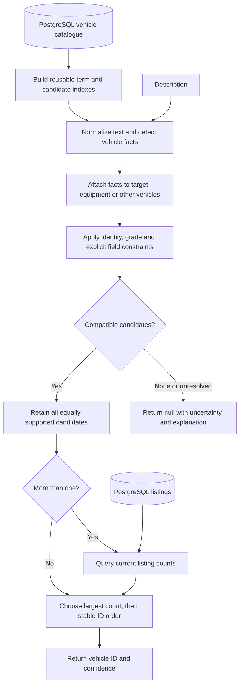

# Vehicle matcher

A TypeScript program that matches free-text car descriptions to a PostgreSQL vehicle catalogue. It returns a vehicle ID or `null`, plus a confidence score from 0 to 10. Matching runs locally without a language model or paid inference API.

## Quick start

Requires Node.js 22.13 or later and PostgreSQL 16. Create an empty database you own:

```sh
npm ci
createdb autograb
export DATABASE_URL='postgresql://localhost:5432/autograb'
npm run setup
npm run match
```

Use your own database credentials if authentication is required. `PGHOST`, `PGPORT`, `PGDATABASE` and standard PostgreSQL authentication variables are also supported. Setup creates an `autograb` schema and refuses to overwrite it. The original supplied files are preserved; a documented column-name typo is corrected only in memory during setup.

```sh
npm run match -- /absolute/path/to/descriptions.txt
npm run match -- --diagnostics
npm run web
```

The optional web page opens at **http://127.0.0.1:4317**. It uses the same matcher as the CLI. Restart long-running processes after catalogue or source changes; the web status endpoint detects stale snapshots.

## Example

One JSON object is printed for each nonblank input line:

```json
{"input":"Volkswagen Golf 110TSI Comfortline Petrol Automatic Front Wheel Drive","vehicleId":"4749339721203712","confidence":9}
{"input":"Ford Ranger XLT Dual Cab","vehicleId":null,"confidence":2}
```

A `null` with low confidence means interpretation or catalogue absence is uncertain. Operational failures are separate error records with a nonzero process exit status; they are never reported as confident absence. Confidence is a heuristic, not a calibrated probability.

## Algorithm



Counts break semantic ties; they do not make an incompatible car a better match. Analysis is cached by exact input within one catalogue snapshot. The selected ID is not cached across listing-count changes.

## Tests and performance

```sh
npm run lint
npm run format:check
npm run check
npm test
npm run test:integration
npm run test:web
npm run benchmark -- --scale
npm run evaluate
```

Unit tests run without PostgreSQL. Integration, API and benchmark commands use the configured database; integration/scale checks create and remove disposable schemas. CI runs the same formatting, typed lint, browser build, setup, type, unit, database, API and CLI checks with PostgreSQL. Benchmark output is written to `results/benchmark.json`.

## Accuracy and limitations

The latest frozen evaluation scored **39/42 selected IDs and complete candidate sets (92.9%)**, with one wrong selection and two missed matches. This is a small convenience sample with provisional agent labels, not a human-adjudicated production estimate. It was used for implementation selection, not independent post-selection confirmation. **100% accuracy is not claimed.**

Known difficult cases include gearbox override equipment, optional packages when the grade is omitted, and unsupported grade names. Rules cannot resolve all inaccurate seller descriptions. The measured 10,000-vehicle/100,000-listing workload is a synthetic performance check, not a production capacity guarantee. External inference spend is zero; CPU, database and engineering costs are not zero.

See [assumptions and decisions](docs/ASSUMPTIONS.md), [validation evidence](docs/VALIDATION.md), [requirement audit](docs/REQUIREMENTS.md), and [AI assistance](AI_ASSISTANCE.md). The challenge and original data are in [supplied/](supplied/README.md).
